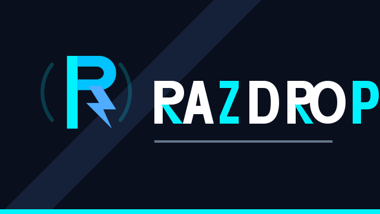
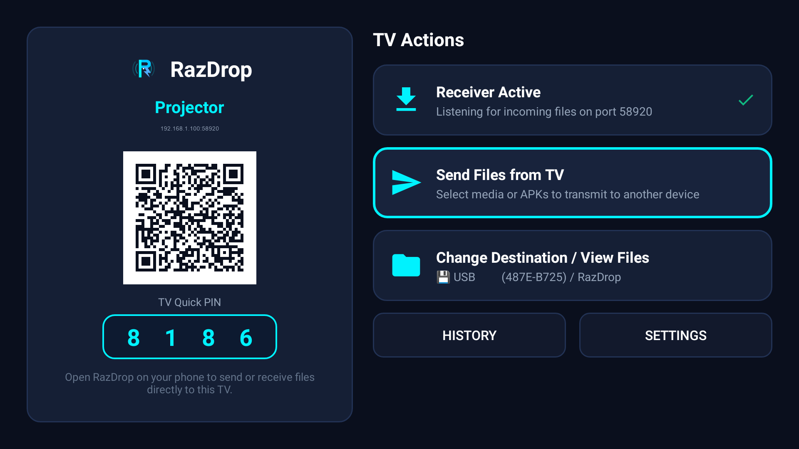
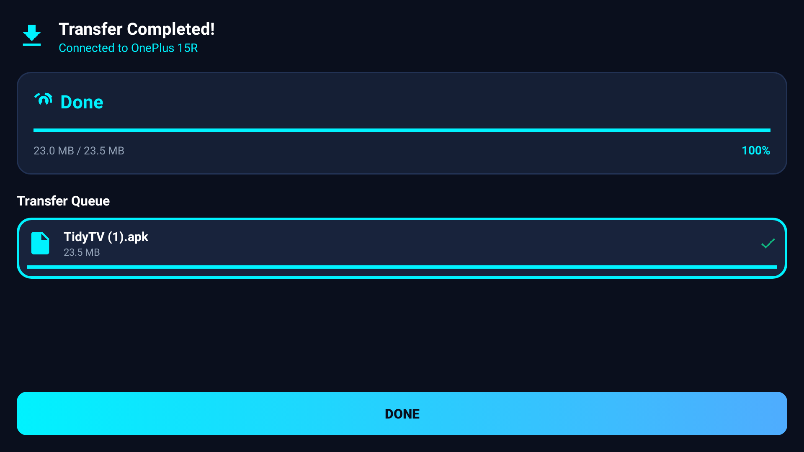
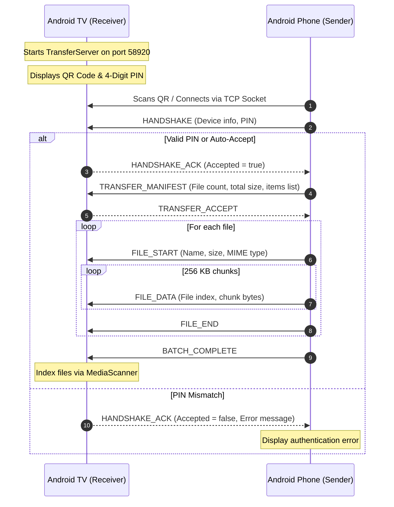

<div align="center">



# Razdrop

**High-speed, zero-cloud offline file sharing between Android phones and Android TV.**

[](https://www.android.com)
[-blue.svg?style=flat)](https://android-arsenal.com/api?level=26)
[](LICENSE)
[]()

*Transfer large movies, APKs, documents, and photo albums directly between your mobile devices and television—without an internet connection, cloud relay, or home Wi-Fi router.*

</div>

---

## Overview

Transferring large files—such as high-definition videos, raw photos, or application APKs—to an Android TV has traditionally been painful. Most existing solutions either require uploading files to third-party cloud servers, connecting cumbersome USB flash drives, or forcing both devices onto an internet-connected Wi-Fi router with complex IP typing.

**Razdrop** solves this problem with an **offline-first, peer-to-peer streaming engine**. Using direct local wireless connections (Wi-Fi Direct, Local-Only Hotspots, or local LAN mDNS), Razdrop establishes high-throughput TCP socket streams between devices, delivering raw speeds limited only by device hardware.

Whether you are in a living room with no internet connection, in a hotel room with strict network isolation, or on the road, Razdrop connects your phone and television in seconds.

---

## Key Features

- **True Bidirectional Sharing (TV-to-Phone & Phone-to-TV):**
  - **TV-to-Phone Transfer:** Extract videos, recorded streams, application backups, or files stored on TV-connected USB drives directly back to your smartphone—controlled entirely with a standard D-pad TV remote without requiring a camera on the TV.
  - **Phone-to-TV Transfer:** Instantly beam large movies, TV show episodes, photos, and app APKs from your phone to the big screen without cloud lag or upload limits.
  - **Phone-to-Phone Transfer:** Fast peer-to-peer sharing between Android smartphones and tablets.
- **Camera-Free TV Pairing:** Android TVs rarely have cameras. Razdrop displays a high-contrast QR code and a **4-digit pairing PIN** on the TV screen; the phone scans the QR code or enters the PIN to authenticate instantly.
- **3-Tier Offline Networking:**
  - **Wi-Fi Direct (`WifiP2pManager`):** Negotiates a direct peer-to-peer wireless link without an external router or access point.
  - **Local-Only Hotspot (`WifiManager.LocalOnlyHotspotReservation`):** Creates an ad-hoc 5 GHz or 2.4 GHz private Wi-Fi access point directly from the device without requiring cellular data.
  - **Local LAN Discovery (`NsdManager`):** Automatically discovers nearby peers using mDNS (`_razdrop._tcp`) and UDP discovery beacons when devices share an existing network.
- **Dedicated 10-Foot Leanback UI:** Custom television interface designed specifically for D-pad navigation, high-contrast TV focus rings, and Leanback launcher integration.
- **Custom Receiving Location & External Storage:** Choose any target folder on internal storage or write directly to attached **USB flash drives** / external hard drives.
- **Binary-Framed Streaming Protocol (`RAZ1`):** Custom framed transport protocol with 256 KB streaming chunks and 1 MB TCP socket buffers, preventing memory exhaustion on RAM-constrained TVs.
- **Foreground Service Reliability:** Transfers run inside a persistent Android `ForegroundService` with `WakeLock` and `WifiLock` to prevent the OS from terminating long-running transfers during screen sleep.
- **Real-Time Throughput Metering:** Live calculation of transfer speed (MB/s), smooth ETA estimation, and automatic Android MediaScanner indexing upon transfer completion.

---

## Visual Presentation

<div align="center">

| Android TV Leanback Dashboard | Android TV Transfer Dashboard |
| :---: | :---: |
|  |  |
| *10-foot Leanback TV dashboard with "Send Files from TV" focused for frictionless TV-to-Phone transfers and QR/PIN pairing* | *Live transfer completion monitoring on Android TV with 100% verified delivery* |

</div>

---

## How It Works

### TV-to-Phone Transfers (Camera-Free)
1. On your Android TV, navigate with your remote control to **Send Files from TV**.
2. Select any media files, documents, or APKs from internal storage or connected **USB flash drives**.
3. On your phone, tap **Receive** or scan the TV's pairing code to establish the direct connection.
4. Files stream directly from your TV to your phone over the high-speed local link.

### Phone-to-TV Transfers
1. Open Razdrop on your TV to view the instant connection QR code and 4-digit PIN.
2. On your phone, tap **Send**, choose your files, and point your camera at the TV's QR code (or enter the PIN).
3. Transfers begin immediately with real-time throughput metering. Files are automatically organized and indexed into your chosen TV destination folder or USB drive.

> [!NOTE]
> Additional high-resolution device captures will be archived in the [`docs/screenshots/`](docs/screenshots/) folder.

---

## Architecture & Technical Design

### High-Throughput Protocol (`RazPacket`)

Transfers are controlled by a custom framed binary protocol designed for deterministic memory consumption and rapid sync recovery:

```
+---------------------------------------------------------------+
|                      RazPacket Wire Frame                     |
+-------------------+--------------------+----------------------+
| Magic (4 Bytes)   | Type (1 Byte)      | Length (4 Bytes BE)  |
| 0x52 41 5A 31     | PacketType Enum    | Payload Byte Count   |
| ("RAZ1")          | (e.g., FILE_DATA)  | (Up to 128 MB limit) |
+-------------------+--------------------+----------------------+
|                       Payload Data                            |
|     - JSON Metadata (Handshake, Manifest, FileHeader)         |
|     - Raw Binary Chunks (4B FileIndex + 256 KB Data)          |
+---------------------------------------------------------------+
```

### Connection Flow



### Security Model & Design Boundaries

- **Zero Cloud Infrastructure:** 100% of network packets travel strictly over the local link. No data, telemetry, or metadata ever leaves the physical vicinity.
- **Mutual Device Authentication:** A receiver requires explicit user acceptance or PIN/QR matching before socket data streams begin.
- **Unencrypted Local TCP Stream:** Because Razdrop operates over isolated Wi-Fi Direct or private Local Hotspots created directly between the two peer devices, transport data is streamed over unencrypted TCP sockets for maximum transfer speed on low-power TV processors. Do not use Razdrop over untrusted, public Wi-Fi networks for confidential files.

---

## Installation

### For Android Phones & Tablets

1. Download the latest `RazDrop.apk` from the **[GitHub Releases](https://github.com/Rajdroid3/razdrop/releases)** page.
2. Tap the downloaded APK to install.
3. If prompted, allow installation from unknown sources in Android Settings.
4. Launch Razdrop and grant the requested permissions:
   - **Nearby Devices / Wi-Fi:** Required for peer discovery and local hotspot connections.
   - **Camera:** Required for scanning pairing QR codes displayed on the TV.
   - **All Files Access (`MANAGE_EXTERNAL_STORAGE`):** Required to read and save files across storage directories.
   - **Notifications:** Required to keep the foreground transfer service active in the background.

### For Android TV / Google TV

Android TVs can be installed using any of the following methods:

#### Method A: ADB Sideload (Recommended)
Connect your PC to your TV over Wi-Fi:
```bash
adb connect <TV_IP_ADDRESS>:5555
adb install -r RazDrop.apk
```

#### Method B: USB Flash Drive
1. Copy `RazDrop.apk` onto a USB flash drive.
2. Plug the USB drive into your Android TV.
3. Open a file manager on your TV (such as *File Commander* or *FX File Explorer*) and install the APK.

---

## Building from Source

### Prerequisites

- **JDK:** Java 17 (OpenJDK 17 or Microsoft Build of OpenJDK 17)
- **Android SDK:** Platform 34 (`Android 14 UpsideDownCake`)
- **Android Build Tools:** 34.0.0
- **Gradle:** 8.9 (included via Gradle Wrapper)

### Build Commands

1. **Clone the repository:**
   ```bash
   git clone https://github.com/Rajdroid3/razdrop.git
   cd razdrop
   ```

2. **Configure SDK Path:**
   Create a `local.properties` file in the project root:
   ```properties
   sdk.dir=/path/to/your/android-sdk
   ```

3. **Compile the Universal APK:**
   - **Debug Build:**
     ```bash
     ./gradlew assembleDebug
     ```
     *Output:* `app/build/outputs/apk/debug/app-debug.apk`

   - **Release Build:**
     ```bash
     ./gradlew assembleRelease
     ```
     *Output:* `app/build/outputs/apk/release/app-release-unsigned.apk`

4. **Run Unit Tests:**
   ```bash
   ./gradlew test
   ```

---

## Troubleshooting & FAQ

### 1. Devices fail to discover each other
- **Check Wi-Fi Band / AP Isolation:** Some modern Wi-Fi routers enable "Client Isolation" or "AP Isolation", preventing connected devices from speaking to one another.
  - *Fix:* Use Razdrop's built-in **Local Hotspot** mode or **Wi-Fi Direct** mode, bypassing the home router entirely.
- **5 GHz vs 2.4 GHz:** Older Android TVs may only support 2.4 GHz Wi-Fi. Ensure the sender is using a compatible frequency band.

### 2. QR Code scanning fails
- If the TV screen produces glare or reflections preventing the camera from scanning, tap **Connect with PIN** on your phone and enter the 4-digit PIN displayed on the TV screen.

### 3. Transfer speed is slow (under 5 MB/s)
- When using a mobile hotspot on older 2.4 GHz Wi-Fi, theoretical speeds are often capped around 5–8 MB/s. Switching your phone's hotspot band to **5 GHz** will typically increase throughput to **25–40+ MB/s**.

### 4. Transfers interrupt when the screen turns off
- Ensure battery optimization is set to **Unrestricted** for Razdrop in your Android device settings so background Wi-Fi locks are honored.

---

## Contributing

We welcome contributions! Please review our [Contribution Guidelines](CONTRIBUTING.md) and [Security Policy](SECURITY.md) before opening a pull request or issue.

1. Fork the Project.
2. Create your Feature Branch (`git checkout -b feature/AmazingFeature`).
3. Commit your Changes (`git commit -m 'feat: add amazing feature'`).
4. Push to the Branch (`git push origin feature/AmazingFeature`).
5. Open a Pull Request.

---

## License

This project is licensed under the **Apache License 2.0** - see the [LICENSE](LICENSE) file for details.
